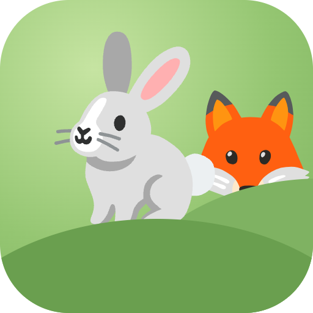

<p align="center">
  
</p>

<h1 align="center">Nobody's Meadow</h1>

<p align="center"><em>A cozy cooking game in a painted meadow.</em></p>

You'll gather what the meadow gives, build up a kitchen from a campfire, and cook. The cooking isn't built yet: for
now there's the meadow, and you can look around it.

The meadow lives on its own. Rabbits graze and dig their burrows, foxes hunt them, otters fish the river, crows
peck about and bury acorns, frogs spawn in the flood pools, and bees fill their hives with honey while the flowers
are out. Apples fall in autumn, the water rises in spring and freezes in winter. A day lasts twelve minutes and a
season a week, and if the rabbits or foxes get few, more wander in.

Every meadow is different: a river, a lake or both, ponds, woods, great rocks and named flower fields.
`?seed=123` in the address replays one. Your meadow is kept in your browser, so it's where you left it next time.

## Playing

- Click an animal to follow it, or anything else (a hive, a tree, a burrow, a field) to see what it is
- Scroll to zoom and drag to look around; on a phone, pinch and drag
- Quiet sounds and a little felt piano now and then: press 🔊 or M

Keys: <kbd>Space</kbd> pause, <kbd>F</kbd> follow, <kbd>M</kbd> sound, <kbd>+</kbd> <kbd>-</kbd> zoom, <kbd>Esc</kbd> close.

## Running it yourself

No build step, no dependencies. Serve the folder and open http://localhost:8765:

```bash
python3 -m http.server 8765
```

`sim.js` is the world, `game.js` draws it, `ground.js` paints the ground with WebGL, `fur.js` paints the animals,
`trees.js` the trees, and `sound.js` makes every sound with Web Audio. `sound-lab.html` and `tree-lab.html` show the
sounds and the trees on their own.
