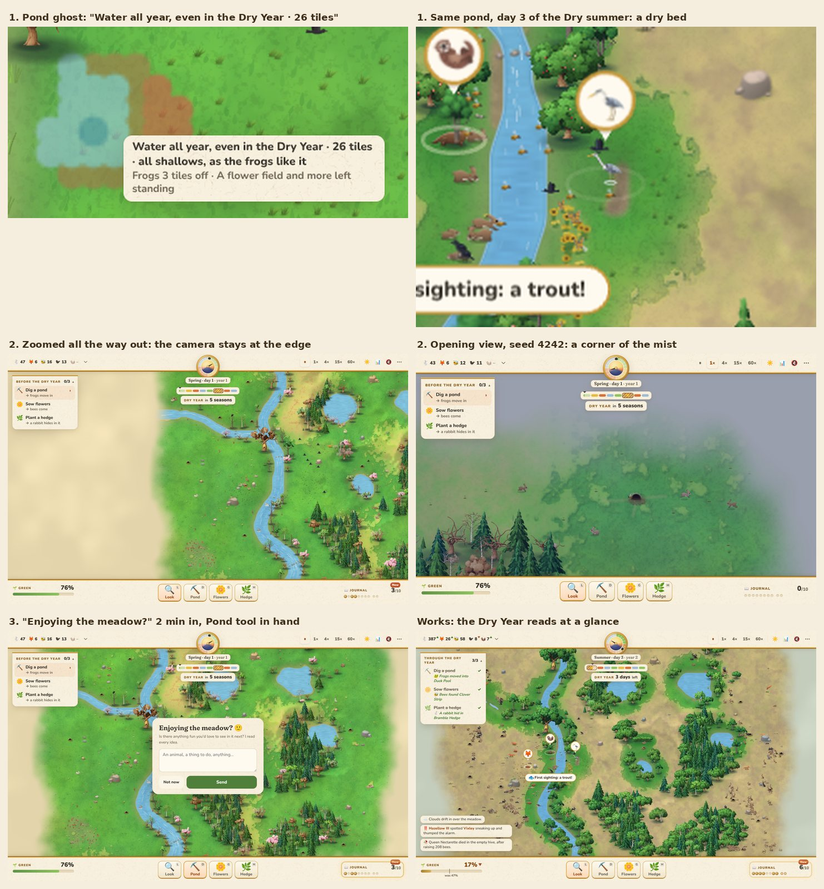

# Keeper-mode playtest

2026-10-13, at 89bd2d1 (main), the default `?keep` meadow. It replaces the partial note of 2026-10-12 (in git
history). That note's six fixes are all in now (35cf136 and after: the welcome, the tasks tied to the Dry Year,
`&dry=N` kept in the link, "–" for a kind not here yet, GREEN's "was" hidden on day 1), and they worked here.

## How it was played

- Headless Chromium (Playwright) with no GPU (SwiftShader): 3 to 9 fps, so smoothness and the feel at speed were not
  judged, and the sound wasn't heard. Time was fast-forwarded at 60x behind the stats page, which skips drawing.
- Desktop, 1440x900, seed 560300: on day 1 a pond by the river, a strip of flowers along it and a hedge by a warren,
  then on through the Dry Year (the summer of year 2) into year 3.
- The same seed with `&dry=1` (the Dry Year this summer) and nothing done.
- Seed 7919 (`balance.js` seed 1) with nothing done: lost to the bees, to see the loss card.
- A phone, 390x844 upright (a pond by finger, pinch, the inspector sheet, the tasks chip, the ••• menu) and 844x390 on
  its side.
- Seed 4242: a reload, the away card (the clock moved on 30 minutes), the stats, Who ate whom, and `?watch`.
- `node balance.js 3 12 idle`, `keep` and `diligent`, and `node balance.js 6 4 v`.
- No console errors or page errors in any of it.

## What works

- The welcome card says what the game is and what's coming, in two short paragraphs.
- The tools answer at once: water appears, the earth turns, crows come down. The ghost and its label follow the
  cursor. On a phone a finger drag places a pond with the label above the finger, and a pinch zooms.
- The payoff is quick. Frogs found the pond the next day and a heron came the day after; a hedgehog came to the hedge,
  and a rabbit got away from a fox into it.
- The Dry Year is the best thing in it to look at: straw everywhere, green rings round the water and the woods. It says
  "the water keeps things alive" without a word.
- The journal's first sightings, with their caption and chime, are charming.
- Keeping the meadow, the away card and the loss card all work, and the phone layouts hold up, upright and on its side.

## Findings, most important first

### 1. The pond's label promises water it won't hold

The pond is the main tool against the Dry Year, and its label overstates what a stroke makes.

- My pond's ghost said "Water all year, even in the Dry Year · 26 tiles · all shallows". It made 15 tiles of water:
  8 last an ordinary summer and 1 the Dry Year. On the third day of the Dry summer it was a dry bed with the heron
  standing in it. The news and the inspector repeated "even through the Dry Year".
- On the phone (seed 31) "A spring pool · 26 tiles" held 3 tiles of water.
- Over 1,200 random blob strokes on 10 seeds, 837 got the "even in the Dry Year" headline. In 131 of them less than a
  quarter of the water lasts the Dry Year, and 700 count tiles that never hold water in the size. The worst: "60 tiles"
  for 7 tiles of water, 1 of them lasting the Dry Year, and 53 too high.
- Why: `placeLabel` headlines on any tile that lasts (`p.lasting`, which with the Dry Year coming counts the tiles
  that last it) and gives the size as `lasting + spring + dry`, the dry ones being too high to hold water. The
  `dugpond` news headlines the same way, and `dugFacts` says "it lasts the summer, even the Dry Year's" whenever one
  tile does (`p.dryLasting`).
- Fix: count only the water, and say how much of it lasts: "15 tiles of water · 1 lasts the Dry Year". Or headline by
  what most of it does.
- **Fixed 2026-10-13** (game.js `pondWords`): the label, the news and the inspector count only the water and headline by
  what most of it does: "Water through an ordinary summer · 15 tiles of water · 1 lasts the Dry Year", with "☀️ Keeps
  N more tiles green in the Dry Year" under it.

### 2. The Dry Year gives no verdict, and nothing to do

- All three tasks were done by summer day 3 of year 1, 18 sim days before the Dry summer. After that there's nothing to
  work towards, and nothing says whether the meadow is ready.
- In the Dry summer GREEN fell from 47% to 15% with no alert and no prompt. I watched a number fall.
- When the rain came back there was no card. TASKS stays at 3/3 for good, the ribbon goes, and there's no goal after.
- The same seed with nothing done (and the Dry Year moved to year 1) came through too: GREEN bottomed at 10%, and the
  bees went from 57 to 5 but held on. Neither run tells you whether your work mattered.
- In `balance.js` the keeper's three small jobs cut the losses from 6 to 2 of 12, but the diligent keeper (three big
  ponds, two hedges, two strips) loses 2 as well, both barren. Past the tasks more work doesn't show in the outcome,
  and the losses left (barren) are the ones the tools barely move.
- After a loss and "Keep watching", the HUD still says "THROUGH THE DRY YEAR 0/3" and "DRY YEAR ½ day left".
- Fix (most of it is D3 in PLAN.md): the came-through card, saying what your work did (the rabbits that grazed by your
  ponds, the sips on your strips, the rabbits that hid in your hedge); before it, a number for GREEN in the Dry Year if
  it came today, that moves as you dig and plant; and tasks that keep going towards it (a pond by each warren far from
  the water).
- **Fixed 2026-10-13** (PLAN.md, D3 as built): the came-through card, the green tiles a stroke keeps in the Dry Year on its
  ghost, a fourth task that keeps going (500 tiles kept green), a "🥀 Green 14%" alert before barren, and the HUD after a
  loss. The forecast is shown as tiles, not as GREEN in the Dry Year: the rabbits graze the real green to about half of it.

### 3. The bees die out just after the loss stops counting

- A loss counts till 3 days after the rain (`DRY_AFTER`). The hives run out of honey right after.
- Of the meadows that came through, the bees died out that autumn or winter in 5 of 6 idle ones and 3 of 10 keeper
  ones (none of the diligent).
- In my do-nothing run the bees went from 57 on the day the rain came to 5 three days later. I first saw their alert
  (`DANGER` 10) on autumn day 4, after the window had closed.
- So a player sees the rain, then "The last bee is gone". Count the bees to the end of that autumn, or warn on the
  honey (PLAN.md's note on the alerts says the same).

### 4. The year after the Dry Year is nearly empty

- In every mode the rabbits boom to 300 to 450 the spring before (mine went from 47 to 443), then crash.
- In year 3 the rabbits are under 50 most of the year in 8 of 12 idle meadows and 6 of 12 keeper and diligent ones,
  and the foxes die out in 7 of 12 idle ones. Mine opened year 3 with 21 rabbits and 6 foxes.
- So the reward for coming through is a near-empty meadow for a year.
- The meadow you watch has long lows too: in `balance.js 6 4 v` the rabbits stay under 50 for two and a half years in
  2 of 4 seeds, often in single digits.

### 5. The news floods

- A fox starving is always news, and so is any rabbit dying old with 10 or more children, which is most of them (the
  `death` case in game.js's news).
- In the winter after the Dry Year 15 lines said "X the fox starved" (18 counting the autumn's last days), and year
  1's autumn and winter had 20 "Old X died peacefully". Your own news (the pond, the hedge, the heron) scrolls away
  under them.
- One said "There weren't enough rabbits or voles" with 419 rabbits alive.
- Fix: one line a day per kind ("4 foxes starved today"), and old age throttled like the rest.

### 6. The camera can show mostly mist

- Zoomed all the way out, the view keeps its centre: on seed 560300 about 40% of the screen was mist and the far side
  of the meadow cut off, on a desktop and on a phone. `clampCam` bounds only the centre, to `MIST_FULL` past the edge.
- The opening view can land in a corner: seed 4242 opens at (132, 4), zoom 28, with a third of the screen grey, keeper
  and watch alike. `homeView` picks the busiest square without keeping the view inside the meadow.
- Fix: keep the view on the meadow while the meadow is bigger than the screen, and centre it once it isn't.

### 7. The ideas card comes too early

- "Enjoying the meadow?" comes after 2 minutes of play (`ASK_MS`). For a keeper that's the middle of the first task:
  it opened just as I took the Pond tool from the task card.
- It takes the focus (`askIdeas`), so Space or D types into its box.
- Fix: wait till the first task is done or the Dry Year is over, and never with a tool in hand.

## Smaller things

- The water inspector says "About 1 frogs in the wet grass round it".
- The mast-year news says "jays will bury them"; the crows do.
- "The crows are crashing: 6 left, down from 22", the same line twice, once each side of a season change
  (`checkPopulationNews` says it once a season).
- The pond says "Frogs 3 tiles off could find it", then "Frogs found Duck Pool, from 21 tiles off".
- The ordinary "Mirror River has dropped low for the summer. There are more places to wade across." comes right after
  the Dry Year's first line.
- The heron came back to Duck Pool in the Dry summer and stood fishing in its dry bed (one tile of it lasts the Dry
  Year).
- The stats legend offers "you changed the weather" at `?keep`, a new meadow's chart says "over the last 5 years" on
  day 3, and How they died can add up to 101% (88 + 13).
- A hover label stays on an animal that walks away while the mouse rests (`hoverId` is set only on a pointer move).
- After a reload, "Young bees are hatching" twice in a row (the news gaps, `ui.lastNews`, aren't kept).
- In the Dry Year the wilted plants read as rows of little brown "Y"s.
- Lightning fires are frequent: 6 by the start of year 2's summer, 3 of them in the spring before the Dry Year, and 4
  around seed 7919's Dry summer. PLAN.md keeps fire on purpose; noted only.

## Balance

`balance.js`, 3 years, seeds 1 to 12 each:

| The keeper | Lost the Dry Year | Came through, then the bees died out that autumn or winter | Year 3: rabbits under 50 most of the year | Foxes died out in year 3 |
|---|---|---|---|---|
| idle | 6 (5 bees, 1 barren) | 5 of 6 | 8 | 7 |
| keep (a pond, two strips, a hedge) | 2 (1 bees, 1 barren) | 3 of 10 | 6 | 1 |
| diligent (three big ponds, two hedges, two strips) | 2 (both barren) | 0 of 10 | 6 | 1 |

PLAN.md's counts (idle 12 of 16, keep 8 of 16) are out of date: on seeds 1 to 8 idle now loses 4 where it lost 6.
The Dry Year is easier than PLAN.md says.

## Checked and fine

- `packWorld` keeps each object once and points to it, so a rabbit's `hedgeTo` (a whip of `w.decor`) is the same whip
  after a reload (the 2026-10-12 audit's worry 2).
- The crows' `atTurned` reads `c.target.turned`, but every `'forage'` sets a target and crows fly, so `moveToward`'s
  "boxed in" never empties it. No crash in 2½ years with a pond dug (the audit's worry 1).
- The loss card sits over the stats page (z-index 10 over 8), and Esc closes it first.
- At `?keep` the sky button says the weather in the news.
- A tap on a tool on a phone shows its card for 4 seconds.
- A tree first drawn blurry sharpens a few seconds after opening (the tree worker).
- A reload keeps the meadow (tick, ponds, news), and the away card after 30 minutes away works.

## Order

1. The pond's label: small, and it's the main tool.
2. A verdict for the Dry Year: D3's card, and a GREEN forecast that moves while you place things.
3. The news, then the camera.

## Doing it again

- Fast-forward at 60x with the stats page open (S): it skips drawing, about 880 ticks a second here against under 30
  with the meadow drawn and no GPU. Pause with `garden.ui.speed = 0`, then close the stats page to look.
- A keeper meadow at `?seed=N` is `balance.js` seed N / 7919 (`createWorld(s * 7919, { keep })`), so a seed that
  `balance.js` loses can be watched. It drifts a little: seed 7919 lost its bees on day 30.5 in the browser, 32.8 in
  `balance.js`.
- `&dry=1` brings the Dry Year to this summer.
- `aeon-garden-keep-welcomed = 1` in localStorage skips the welcome, and `aeon-garden-asked = 1` the ideas card.
